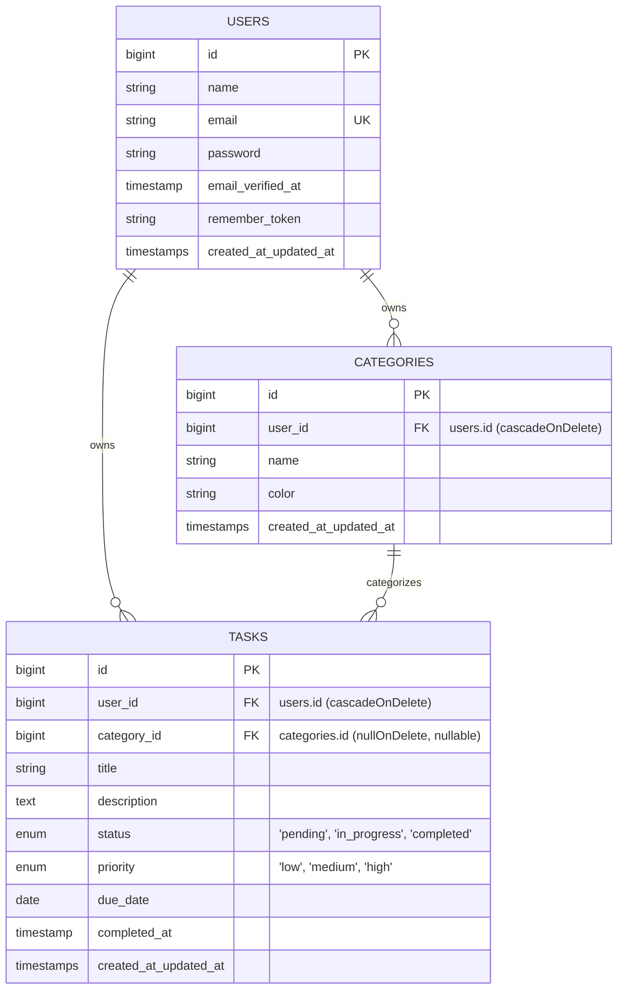

# TUNTAS — Student Task Management System

<p align="center">
  
</p>

<p align="center">
  <strong>A modern, responsive, and minimalist task management web application engineered specifically for students.</strong>
</p>

<p align="center">
  
  
  
  
  
  
</p>

---

## 📋 Daftar Isi

1. [Tentang TUNTAS](#-tentang-tuntas)
2. [Teknologi & Stack](#-teknologi--stack)
3. [Fitur Utama](#-fitur-utama)
4. [Arsitektur & Desain Basis Data (ERD)](#-arsitektur--desain-basis-data-erd)
5. [Prasyarat Sistem](#-prasyarat-sistem)
6. [Panduan Instalasi & Setup](#-panduan-instalasi--setup)
7. [Akun Demo & Seeder](#-akun-demo--seeder)
8. [Pengujian Otomatis (Testing)](#-pengujian-otomatis-testing)
9. [Struktur Direktori Proyek](#-struktur-direktori-proyek)
10. [Aturan Pengembangan & Bisnis](#-aturan-pengembangan--bisnis)

---

## 📌 Tentang TUNTAS

**TUNTAS** adalah aplikasi web manajemen tugas berbasis *Modern Minimalist SaaS Dashboard* yang dirancang untuk membantu mahasiswa dan pelajar mengelola jadwal akademik, tenggat waktu (*deadline*), proyek, dan catatan pribadi secara terstruktur dan bebas distraksi.

Aplikasi ini mengedepankan performa tinggi dengan arsitektur reaktif SPA (*Single Page Application*) tanpa overhead JavaScript frontend framework eksternal yang berat, memanfaatkan integrasi erat antara **Laravel 13**, **Livewire 4**, dan **Tailwind CSS 4**.

---

## 🚀 Teknologi & Stack

- **Backend Framework**: Laravel 13 (`laravel/framework` v13.40.x)
- **Reactivity Layer**: Livewire 4 (`livewire/livewire` v4.4.x)
- **Language**: PHP 8.4+ (diuji pada PHP 8.5)
- **Database**: MySQL 8.0+ / MariaDB 10.4+
- **Frontend Template**: Blade + Alpine.js (terintegrasi di Livewire 4)
- **CSS Framework**: Tailwind CSS 4 (`@tailwindcss/vite` plugin resmi)
- **Asset Bundler**: Vite 7
- **Testing Engine**: PHPUnit 12

---

## ✨ Fitur Utama

### 1. Autentikasi Mandiri & Aman
- Pendaftaran akun mahasiswa (`/register`) dengan validasi kata sandi kuat.
- Masuk sesi (`/login`) dengan dukungan *remember me* dan regenerasi sesi proteksi *session fixation*.
- Keluar sesi aman (`POST /logout`) terproteksi token CSRF.

### 2. Dashboard Interaktif (Real-Time Statistics)
- Ringkasan metrik riil teragregasi: Total Tugas, Sedang Berjalan (*In Progress*), Terlambat (*Overdue*), dan Selesai (*Completed*).
- Persentase penyelesaian tugas (*Completion Rate %*).
- Peringatan khusus tugas yang jatuh tempo (*Overdue Alert Banner*) dengan aksi cepat *Mark Done*.
- Daftar tenggat waktu terdekat (*Upcoming Deadlines*).
- Distribusi tugas per kategori beserta bilah kemajuan (*category progress bar*).

### 3. Manajemen Tugas (Task CRUD & Lifecycle)
- **Pembuatan Tugas**: Form modal intuitif (Judul, Deskripsi, Kategori, Prioritas, Status, Tenggat Waktu).
- **Status Siklus Tugas**: `pending`, `in_progress`, `completed`.
  - Mengubah status ke `completed` otomatis menetapkan `completed_at` ke waktu terkini.
  - Mengubah status kembali ke belum selesai otomatis mengosongkan `completed_at`.
- **Tingkat Prioritas**: `low`, `medium`, `high` dengan aksen token warna jelas.
- **Deteksi Keterlambatan (*Overdue Detection*)**: Evaluasi otomatis terhadap tugas yang tanggal jatuh temponya lebih awal dari hari ini dan statusnya belum `completed`.
- **Detail & Aksi Cepat**: Modal rincian tugas komprehensif, ubah status langsung dari daftar, edit modal, dan konfirmasi penghapusan modal aman.

### 4. Manajemen Kategori (Category CRUD)
- Pengelompokan tugas berdasarkan subjek akademik atau jenis proyek.
- Palet pemilihan warna kategori (*Curated Hex Color Picker*) untuk diferensiasi visual.
- Indikator jumlah tugas terhubung pada tiap kartu kategori.
- Mekanisme aman: Penghapusan kategori tidak menghapus tugas, melainkan mengatur `category_id` menjadi `NULL` (`nullOnDelete`).

### 5. Pencarian, Pemfilteran, & Penomoran Halaman (Discovery)
- Pencarian instan teks (*real-time debounced search*) berdasarkan judul dan deskripsi.
- Filter terpadu: Status, Prioritas, dan Kategori.
- Penataan urutan (*Sort by deadline, title, priority, status*).
- Sinkronisasi URL query string (`#[Url]`) sehingga hasil filter dapat di-bookmark atau dibagikan.
- Penomoran halaman responsif (*Livewire Pagination*) yang otomatis ter-reset saat filter diubah.

### 6. Isolasi Kepemilikan Data Pengguna (Multi-Tenant Data Ownership)
- Setiap pengguna hanya dapat melihat, menambah, mengubah, dan menghapus tugas dan kategori miliknya sendiri.
- Kebijakan otorisasi ketat diterapkan di tingkat basis data dan controller menggunakan **Eloquent Policies** (`TaskPolicy` & `CategoryPolicy`).
- Kategori yang dipilih saat membuat atau mengedit tugas divalidasi harus milik pengguna yang sama.

---

## 🗄 Arsitektur & Desain Basis Data (ERD)

Aplikasi berpusat pada 3 entitas utama:



---

## 💻 Prasyarat Sistem

Sebelum menjalankan aplikasi, pastikan perangkat Anda memiliki:

- **PHP**: versi `8.3` atau lebih tinggi (disarankan `8.4+`)
  - Ekstensi PHP yang dibutuhkan: `pdo_mysql`, `mbstring`, `curl`, `openssl`, `tokenizer`, `xml`, `ctype`, `json`.
- **Composer**: versi `2.x`
- **Node.js**: versi `20.x` atau lebih tinggi & **npm** versi `10.x+`
- **MySQL / MariaDB**: Server MySQL aktif pada port `3306`

---

## 🛠 Panduan Instalasi & Setup

Ikuti langkah-langkah berikut untuk menjalankan proyek dari awal di lingkungan lokal Anda:

### 1. Masuk ke Direktori Proyek
```bash
cd c:\Users\Windows\Desktop\Projects\TUNTAS
```

### 2. Pasang Dependensi Backend (PHP / Composer)
```bash
composer install
```

### 3. Pasang Dependensi Frontend (Node / npm)
```bash
npm install
```

### 4. Konfigurasi Lingkungan (`.env`)
Salin file konfigurasi lingkungan jika belum tersedia:
```bash
cp .env.example .env
```

Pastikan variabel basis data MySQL pada file `.env` telah disesuaikan:
```env
APP_NAME=TUNTAS
APP_ENV=local
APP_KEY=
APP_DEBUG=true
APP_URL=http://localhost:8000

DB_CONNECTION=mysql
DB_HOST=127.0.0.1
DB_PORT=3306
DB_DATABASE=tuntas
DB_USERNAME=root
DB_PASSWORD=root
```
*(Catatan: Sesuaikan `DB_USERNAME` dan `DB_PASSWORD` dengan kredensial server MySQL lokal Anda).*

### 5. Generate Application Key
```bash
php artisan key:generate
```

### 6. Buat Basis Data & Jalankan Migrasi
Pastikan database MySQL bernama `tuntas` telah dibuat, lalu jalankan migrasi:
```bash
php artisan migrate
```

### 7. Jalankan Seeder Demo Data
Untuk mengisi akun demo dan data simulasi tugas mahasiswa:
```bash
php artisan db:seed
```

### 8. Kompilasi Aset Frontend
```bash
npm run build
```
*(Untuk pengembangan aktif dengan Live Reload, Anda dapat menggunakan `npm run dev`)*.

### 9. Jalankan Server Lokal
```bash
php artisan serve
```
Buka peramban (*browser*) Anda dan akses: **`http://127.0.0.1:8000`**

---

## 👤 Akun Demo & Seeder

Database seeder (`DemoSeeder`) menyediakan data siap pakai untuk pengujian:

| Role / Akun | Alamat Email | Kata Sandi | Keterangan |
|---|---|---|---|
| **Demo Student** | `student@tuntas.test` | `password` | Akun utama berisi kategori akademik dan contoh tugas aktif, overdue, dan selesai. |
| **Isolated Student** | `other@tuntas.test` | `password` | Akun kedua untuk membuktikan isolasi data antar pengguna (*multi-tenancy*). |

---

## 🧪 Pengujian Otomatis (Testing)

Aplikasi dilengkapi dengan pengujian menyeluruh (Unit & Feature Tests) yang mencakup autentikasi, integritas basis data, kepemilikan data pengguna (*policies*), penemuan tugas (*search & filters*), dan operasi CRUD.

Jalankan seluruh test suite menggunakan perintah:
```bash
php artisan test
```

### Ringkasan Hasil Pengujian (Semua Lolos):
```text
   PASS  Tests\Unit\ExampleTest (1 test)
   PASS  Tests\Feature\AuthenticationTest (7 tests)
   PASS  Tests\Feature\CategoryManagementTest (16 tests)
   PASS  Tests\Feature\DashboardIntegrationTest (3 tests)
   PASS  Tests\Feature\DatabaseAndOwnershipTest (4 tests)
   PASS  Tests\Feature\ExampleTest (1 test)
   PASS  Tests\Feature\TaskDiscoveryTest (11 tests)
   PASS  Tests\Feature\TaskManagementTest (19 tests)

   Tests:    62 passed (234 assertions)
   Duration: ~5.5s
```

---

## 📁 Struktur Direktori Proyek

Berikut adalah gambaran berkas dan modul kunci dalam aplikasi:

```text
TUNTAS/
├── app/
│   ├── Http/
│   │   └── Controllers/
│   │       └── Auth/AuthController.php      # Pengendali login, register, dan logout
│   ├── Livewire/
│   │   ├── Dashboard.php                    # Komponen reaktif statistik dashboard
│   │   ├── TaskManager.php                  # Komponen CRUD tugas, filter, & pencarian
│   │   └── CategoryManager.php              # Komponen CRUD kategori & manajemen warna
│   ├── Models/
│   │   ├── User.php                         # Model autentikasi & relasi data
│   │   ├── Category.php                     # Model kategori tugas
│   │   └── Task.php                         # Model tugas, lifecycle completed_at, scopes
│   └── Policies/
│       ├── CategoryPolicy.php               # Aturan otorisasi kepemilikan kategori
│       └── TaskPolicy.php                   # Aturan otorisasi kepemilikan tugas
├── database/
│   ├── factories/                           # CategoryFactory, TaskFactory, UserFactory
│   ├── migrations/                          # Migrasi users, categories, dan tasks
│   └── seeders/                             # DemoSeeder & DatabaseSeeder
├── resources/
│   ├── css/
│   │   └── app.css                          # Konfigurasi Tailwind CSS 4 & font tokens
│   ├── views/
│   │   ├── auth/                            # Template Blade login & register
│   │   ├── layouts/
│   │   │   └── app.blade.php                # Shell responsif (Sidebar, Header, Flash alerts)
│   │   └── livewire/
│   │       ├── dashboard.blade.php          # Tampilan metrik & upcoming tasks
│   │       ├── task-manager.blade.php       # Tampilan antarmuka manajemen tugas
│   │       └── category-manager.blade.php   # Tampilan antarmuka manajemen kategori
├── routes/
│   └── web.php                              # Rute web dengan proteksi middleware guest & auth
├── tests/
│   └── Feature/                             # Pengujian Feature komprehensif
├── package.json                             # Konfigurasi Vite & Tailwind CSS 4
├── vite.config.js                           # Vite bundler dengan plugin @tailwindcss/vite
└── README.md
```

---

## 📜 Aturan Pengembangan & Bisnis

1. **Aturan Hak Milik**: Pengguna tidak boleh mengakses, melihat, mengubah, atau menghapus kategori atau tugas milik pengguna lain.
2. **Kategori Valid**: Tugas hanya dapat dikaitkan dengan kategori yang dimiliki oleh pembuat tugas tersebut.
3. **Integritas Penghapusan**: Menghapus kategori tidak menghapus tugas terkait; relasi foreign key diatur `NULL`.
4. **Logika Tenggat Waktu**:
   - Tugas dinyatakan *overdue* jika tanggal `due_date` lebih awal dari hari ini dan statusnya belum `completed`.
5. **Standar Kode**: Mengikuti standar PSR-12, konvensi Laravel Eloquent, dan prinsip UI Modern Minimalist Dashboard (menghindari gradien dan bayangan berlebihan).

---

<p align="center">
  Dibuat dengan ❤️ untuk kemudahan dan produktivitas mahasiswa.
</p>
